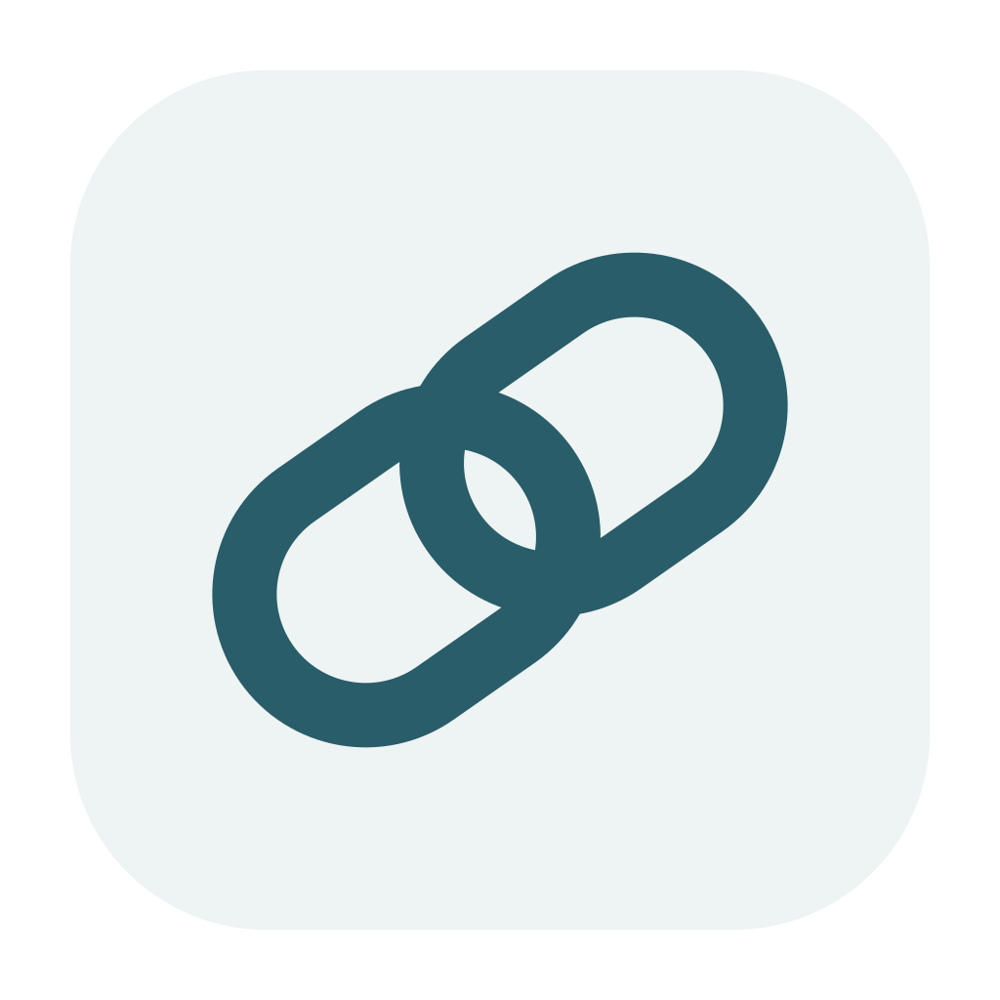
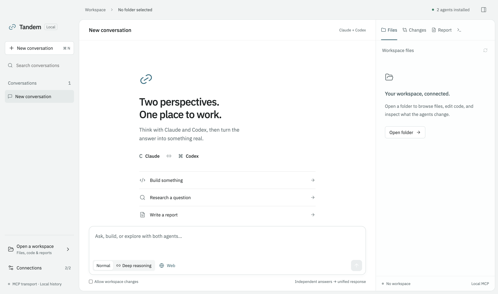
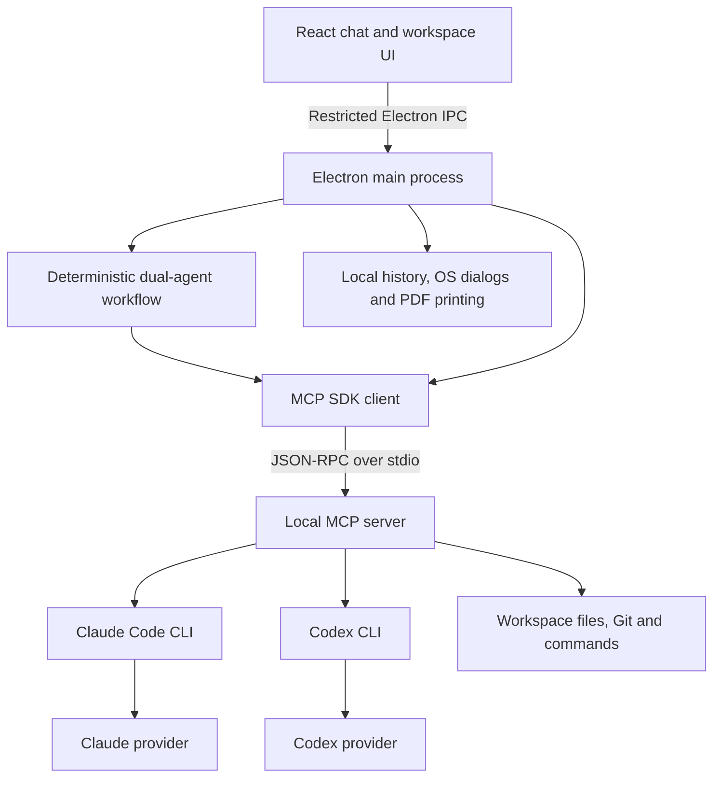

<div align="center">
  
  <h1>Tandem</h1>
  <p><strong>Claude and Codex. One local workspace.</strong></p>
  <p>A macOS agent chat app that brings two perspectives together through MCP.</p>
  <p><a href="#quick-start">Quick start</a> · <a href="#how-the-modes-work">Reasoning modes</a> · <a href="#architecture">Architecture</a> · <a href="CONTRIBUTING.md">Contributing</a></p>
</div>



Ask a question, research a topic, or work on a codebase. Tandem sends your prompt to **Claude Code and Codex**, compares their responses, and returns one cohesive answer. Turn on **Deep reasoning** to add a cross-review and revision before the final response.

The app runs on your Mac, keeps its own chat history locally, and connects to the agents through local **Model Context Protocol (MCP)** adapters. It uses your existing CLI logins; Tandem does not integrate directly with model APIs or ask you to enter API keys.

**Status:** early, source-build release for macOS. Apple Silicon has been tested. Builds are unsigned and not notarized. Model inference still runs with the providers; this is not an offline AI app.

## What you can do

- **Get a unified answer.** Consult both agents independently, then synthesize their conclusions.
- **Go deeper.** Let Codex critique the drafts and Claude revise the answer before synthesis.
- **Keep the evidence.** Expand completed collaboration stages to inspect each agent's output.
- **Work in a folder.** Browse files, edit text, inspect Git diffs, and let Codex implement requested changes.
- **Run local commands.** Review the exact command in a native confirmation dialog before execution.
- **Search the web.** Enable the agents' native web-search capabilities through their MCP adapters.
- **Create reports.** Preview Markdown responses and export formatted A4 PDFs.
- **Pick up where you left off.** Search and reopen conversations stored on your Mac.

## Quick start

### Prerequisites

- macOS. The packaged app has been verified on Apple Silicon; Intel builds have not been verified.
- Node.js **22.12+** or a current Node.js 24 release, with npm.
- Installed **Claude Code** and **Codex** CLIs, with accounts that can use them.
- Git for cloning the project and viewing workspace changes.

The adapters use current CLI flags, including Claude Code's `--restricted` mode. If an older CLI rejects an option, update that CLI before continuing.

### Install and launch

```sh
git clone https://github.com/AhmedSherifRashwan/Tandem.git
cd Tandem
npm ci
```

Verify the CLIs and sign in if needed:

```sh
claude --version
codex --version

claude auth login
codex login
```

Launch the desktop app:

```sh
npm run desktop
```

1. Choose **Open a workspace** and select a trusted folder.
2. Open **Connections** to check whether both CLIs are detected.
3. Enter a prompt and choose **Normal** or **Deep reasoning**.
4. Enable **Allow workspace changes** only when you want the agent to modify the selected workspace.

The connection badge checks installation, not authentication or available usage. Your first real prompt verifies account access. Normal and Deep modes consume your providers' usual allowances.

### Build a Mac app

```sh
npm run package
```

The app bundle is written to `release/tandem/mac-arm64/Tandem.app` on Apple Silicon, or `release/tandem/mac/Tandem.app` for an Intel build. Packaging reuses the installed Electron distribution. There is no signed installer or notarized download in this initial release.

## How the modes work

| Mode | Workflow | Typical model calls |
| --- | --- | ---: |
| Normal | Claude + Codex independently → unified response | 3 |
| Deep reasoning | Independent answers → Codex cross-review → Claude revision → unified response | 5 |
| Workspace changes enabled | Adds one Codex execution pass before final synthesis | +1 |

Independent answers run concurrently. The remaining phases run in order. Synthesis uses Claude when its initial response succeeds, otherwise the available Codex response.

**One writer:** consultation, cross-review, revision, and synthesis are read-only. When workspace changes are enabled, only the Codex execution pass receives `workspace-write`. This avoids two agents editing the same files at once. Write permission resets when the app restarts.

**Visible collaboration:** stages contain the agents' task outputs, critiques, and conclusions—not hidden chain of thought. Stage progress updates live; response text appears when each invocation finishes.

**Failure handling:** if one initial agent fails, the final response discloses that both agents did not cross-check it. If both fail, the app shows an error. A later review or execution failure is shown with completed stage outputs retained. Stopping a task cancels pending calls; changes already made on disk remain available for review.

## Your workspace

| Pane | Behavior |
| --- | --- |
| Files | Browse and edit existing text files up to 1 MB. Saves reject changes made against an out-of-date file. |
| Changes | View tracked Git changes against `HEAD`, plus status entries for untracked files. Repositories without a commit use the unstaged diff. |
| Report | Preview an assistant response as Markdown and export it as a PDF. |
| Terminal | Review and run a command in the selected folder, then inspect its output and exit code. |

The file tools resolve paths and reject traversal or symlinks outside the selected workspace. The editor also protects `.git`, `.aws`, and `.ssh` subdirectories from direct saves.

Explicit Terminal commands run with your Mac user permissions after confirmation. The selected folder is their working directory, **not an operating-system sandbox**. Codex's agent execution pass uses the CLI's workspace sandbox; it does not use a sandbox-bypass flag.

Keyboard shortcuts: **⌘N** for a new conversation, **Enter** to send, and **Shift+Enter** for a newline.

## Architecture



### What “MCP-only” means here

All agent and workspace-tool calls cross the local MCP boundary. The adapters then invoke the installed CLIs, which handle their own authenticated provider requests and built-in tools.

Window controls, history persistence, file-picker dialogs, and PDF printing are desktop infrastructure handled by Electron. There are no direct model API integrations in Tandem.

This project does not connect to the ChatGPT or Claude desktop applications, import their chat histories, or depend on an official general-purpose model-chat MCP server. It is an independent project, not affiliated with OpenAI or Anthropic.

### MCP tools

| Tool | Purpose |
| --- | --- |
| `agent_status` | Detect the installed CLI versions. |
| `agent_generate` | Invoke Claude or Codex with a prompt and workspace context. |
| `workspace_list` | List a directory within the workspace. |
| `workspace_read` | Read a bounded text file. |
| `workspace_write` | Save an existing file with a stale-content check and return a diff. |
| `workspace_diff` | Read Git changes and working-tree status. |
| `workspace_command` | Execute a local command. The desktop client supplies the confirmation step. |

The server uses trusted local stdio; it is not designed to be exposed as a network service. A different MCP client must implement its own user-approval policy for command execution.

### Project map

```text
electron/
  main.cjs          Desktop lifecycle, IPC, history, MCP client, PDF export
  preload.cjs       Narrow API exposed to the isolated renderer
  orchestrator.mjs  Normal/deep workflows and the single-writer pass
mcp/
  server.mjs        MCP tools and CLI adapters
  core.mjs          Process lifecycle, output parsing, path containment
src/                React interface and styles
scripts/            Desktop checks, live-agent checks, icon generation
tests/              Backend, transport, adapter and browser tests
docs/               Design notes, screenshot and verification record
```

Built with Electron, React, TypeScript, Vite, the official MCP SDK, React Markdown, and Lucide. The chat UI is custom React; it does not use the `@assistant-ui/react` package.

## Upgrading from NexusLink

Tandem is the new name for NexusLink. On first launch, Tandem copies existing NexusLink history into its own data folder if no Tandem history exists. The original files are preserved, and existing Tandem history is never overwritten. Close the old app before switching so that the copied history includes your latest conversations.

The older `NEXUS_CLAUDE_BIN` and `NEXUS_CODEX_BIN` overrides remain supported; `TANDEM_*` values take precedence.

## Privacy and configuration

- **Local history:** conversations and completed stage outputs are stored in `~/Library/Application Support/Tandem/history.json`.
- **Provider traffic:** prompts and relevant workspace context are sent through the CLIs to their providers. Provider terms, retention settings, and account limits still apply.
- **Credentials:** the adapters rely on the CLIs' existing authentication. Tandem does not add an API-key settings screen or copy credentials into chat history.
- **App services:** Tandem adds no hosted backend, analytics, or telemetry. The CLIs and providers retain their own behavior and settings.
- **Reports:** raw HTML is not executed, and remote report images are not loaded.

Common executable locations are discovered automatically, including Homebrew, `~/.local/bin`, and NVM installations. Override executable paths when launching from Terminal if needed:

```sh
TANDEM_CLAUDE_BIN=/absolute/path/to/claude \
TANDEM_CODEX_BIN=/absolute/path/to/codex \
npm run desktop
```

## Development and tests

| Command | Purpose |
| --- | --- |
| `npm run dev` | Browser-only UI preview. Native actions require the desktop app. |
| `npm run build` | TypeScript validation and production renderer build. |
| `npm test` | Backend, orchestration, filesystem and real MCP-transport tests. No model accounts required. |
| `npm run test:ui` | Browser interaction/layout checks. Requires Google Chrome. |
| `npm run test:desktop` | Native launch, MCP startup, temporary chat history and PDF checks. |
| `npm run test:agents` | Live MCP requests to both providers; consumes account usage. |
| `npm run package` | Build an unsigned macOS app bundle. |

For a full live desktop chat test:

```sh
npm run build
node scripts/desktop-smoke.mjs --live
```

Native smoke tests use temporary histories and workspaces. CI runs the build and backend tests without provider credentials. The initial verification included 10 backend checks, 4 browser checks, live connections to both agents, a unified desktop response, and PDF export. See [the verification record](docs/verification.md) for the exact scope.

## Troubleshooting

| Symptom | What to check |
| --- | --- |
| A CLI is not detected | Run its `--version` command in Terminal. Check the executable path or use the override variables above. |
| A CLI is installed but prompts fail | Check `claude auth status` or `codex login status`, authenticate if needed, and confirm available account usage. Expand the failed stage for details. |
| Folder access is unavailable in the browser | Start `npm run desktop`; `npm run dev` is only the UI preview. |
| An agent cannot complete a write | Enable workspace changes. Operations outside Codex's sandbox or requiring additional approvals will fail rather than silently escalate. |
| Changes cannot be loaded | Select a Git repository. The file editor can still work in a folder without Git. |
| A file save is rejected | The file changed on disk after it was opened. Reload it before saving. |
| A conversation exceeds the model context | Start a new conversation with a concise summary and the relevant files. |

## Current limitations

- Stage-level updates, not token-by-token streaming.
- Context is replayed from the most recent 20 messages; native provider sessions are not resumed. Large messages can still exceed context limits.
- Custom remote MCP servers are not configurable yet.
- The editor handles existing text files. Agents can create files during the write-enabled execution pass.
- Reports export to PDF; arbitrary PDF attachments are not parsed.
- Deep-mode orchestration is covered by deterministic tests; live deep discussions, web-search results, and agent-written code changes were not separately exercised in the initial verification.
- Public distribution still needs signing, notarization, and further release hardening. Windows and Linux are not supported by this version.

## Contributing

Issues and pull requests are welcome. Read [CONTRIBUTING.md](CONTRIBUTING.md) for local setup, checks, and areas where contributions would help. Please keep the MCP-only connector boundary and single-writer behavior intact.

## License

[MIT](LICENSE). Third-party dependencies retain their own licenses. Claude, ChatGPT, and Codex are names of their respective providers.
